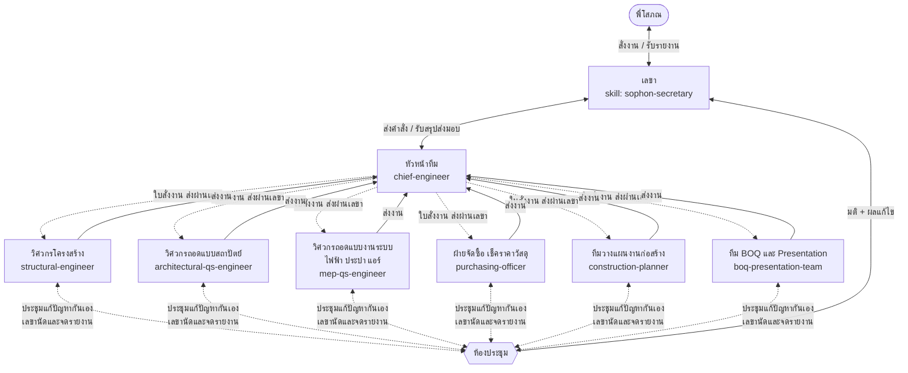

# ทีม AI Agent สำนักงานพี่โสภณ (sophon-office-team)

ปลั๊กอิน Claude Code สำหรับทีมงานประมาณราคาและวางแผนงานก่อสร้าง: **พี่โสภณสั่งงานผ่านเลขาเท่านั้น** เลขาส่งงานให้หัวหน้า หัวหน้าแจกงานให้ 6 ฝ่าย ทุกฝ่ายส่งงานกลับหัวหน้า หัวหน้าสรุปส่งเลขา และเลขารายงานพี่โสภณ ถ้ามีปัญหาข้ามฝ่าย ฝ่ายที่เกี่ยวข้องประชุมแก้กันเอง แล้วรายงานผลผ่านเลขา

## ผังองค์กร



## ลำดับการทำงาน

| ขั้น | ใครทำ | ผลลัพธ์ |
|---|---|---|
| 1 รับคำสั่ง | เลขา | `00_order.md` |
| 2 วางแผน แจกงาน | หัวหน้า | `01_plan.json` (ใบสั่งงานแต่ละฝ่าย) |
| 3 wave A | โครงสร้าง + สถาปัตย์ + งานระบบ ถอดแบบพร้อมกัน, วางแผนร่าง WBS | `takeoff.json` + Backup |
| 4 wave B | จัดซื้อเช็คราคา + วางแผนคำนวณระยะเวลา | `prices.json`, `schedule.json` |
| 5 wave C | ทีม BOQ ประกอบ BOQ Excel + Presentation | BOQ.xlsx, สไลด์, PDF |
| ทุก wave | หัวหน้าตรวจงาน, ไม่ผ่านส่งกลับแก้ | `reviews/wave-X.md` |
| เมื่อมีปัญหา | ฝ่ายที่เกี่ยวข้องประชุมกันเอง (สูงสุด 3 รอบ) | `meetings/MTG-xxx.md` |
| 6 สรุปส่งมอบ | หัวหน้า → เลขา | `90_head_summary.md` |
| 7 รายงาน | เลขา → พี่โสภณ | `99_report_to_sophon.md` |

## ติดตั้ง

```bash
# ใน Claude Code
/plugin marketplace add sophoncost9/bookish-octo-guacamole
/plugin install sophon-office-team@sophon-office
```

หรือคัดลอก `agents/*.md` ไปไว้ที่ `.claude/agents/` และ `skills/sophon-secretary/` ไปไว้ที่ `.claude/skills/` ของโปรเจกต์

## วิธีใช้

พูดกับ Claude เหมือนสั่งเลขา เช่น

- "เลขา ฝากให้ทีมถอดแบบบ้านในโฟลเดอร์ `แบบ/บ้านคุณเอ` ทำ BOQ แผนงาน 6 งวด และสไลด์นำเสนอ ส่งภายในวันศุกร์"
- "เลขา ให้ฝ่ายจัดซื้อเช็คราคาเหล็ก DB12 DB16 3 ร้านแถวนนทบุรี"
- "เลขา สถานะงานเป็นยังไงบ้าง" / "มีปัญหาอะไรไหม"
- "เลขา เปลี่ยนกระเบื้องพื้นเป็น 60x60 แล้วอัปเดต BOQ"

## โครงสร้างไฟล์

```
.claude-plugin/plugin.json, marketplace.json
agents/                         หัวหน้า + 6 ฝ่าย
skills/sophon-secretary/
  SKILL.md                      บทบาทเลขาและกฎการสั่งงาน
  references/workflow.md        ขั้นตอนเต็ม + แม่แบบรายงานพี่โสภณ
  references/handoff.md         โครงแฟ้มงานและรูปแบบไฟล์ส่งต่องาน
  references/meeting-protocol.md ระเบียบการประชุมแก้ปัญหา
  references/team-standards.md  มาตรฐานหน่วย เผื่อ อัตราส่วนตรวจ ราคา
  scripts/office.py             เปิดแฟ้มงาน บันทึกเหตุการณ์ สรุปสถานะ
```
