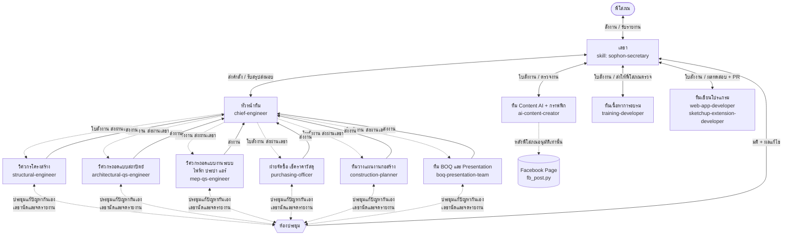

# ทีม AI Agent สำนักงานพี่โสภณ (sophon-office-team)

ปลั๊กอิน Claude Code สำหรับทีมงานประมาณราคาและวางแผนงานก่อสร้าง: **พี่โสภณสั่งงานผ่านเลขาเท่านั้น** เลขาส่งงานให้หัวหน้า หัวหน้าแจกงานให้ 6 ฝ่าย ทุกฝ่ายส่งงานกลับหัวหน้า หัวหน้าสรุปส่งเลขา และเลขารายงานพี่โสภณ ถ้ามีปัญหาข้ามฝ่าย ฝ่ายที่เกี่ยวข้องประชุมแก้กันเอง แล้วรายงานผลผ่านเลขา

## ผังองค์กร



> ทีม Content, ทีมอบรม และทีมเขียนโปรแกรม **ขึ้นตรงกับเลขา** (ไม่ผ่านหัวหน้าทีม QS) แต่ยังใช้ระบบประชุมแก้ปัญหาร่วมกับทุกทีมได้

## ลำดับการทำงาน

| ขั้น | ใครทำ | ผลลัพธ์ |
|---|---|---|
| 1 รับคำสั่ง | เลขา | `00_order.md` |
| 2 วางแผน แจกงาน | หัวหน้า | `01_plan.json` (ใบสั่งงานแต่ละฝ่าย) |
| 3 wave A | โครงสร้าง + สถาปัตย์ + งานระบบ ถอดแบบพร้อมกัน, วางแผนร่าง WBS | `takeoff.json` + Backup |
| 4 wave B | จัดซื้อเช็คราคา + วางแผนคำนวณระยะเวลา | `prices.json`, `schedule.json` |
| 5 wave C | ทีม BOQ ประกอบ BOQ Excel + Presentation | BOQ.xlsx, สไลด์, PDF |
| ทุก wave | หัวหน้าตรวจงาน, ไม่ผ่านส่งกลับแก้ | `reviews/wave-X.md` |
| เมื่อมีปัญหา | ฝ่ายที่เกี่ยวข้องประชุมกันเอง (สูงสุด 3 รอบ) | `meetings/MTG-xxx.md` |
| 6 สรุปส่งมอบ | หัวหน้า → เลขา | `90_head_summary.md` |
| 7 รายงาน | เลขา → พี่โสภณ | `99_report_to_sophon.md` |

## ทีมที่ขึ้นตรงกับเลขา

| ทีม | ขั้นตอน |
|---|---|
| **Content AI + กราฟฟิก** | คิดหัวข้อ → เขียนแคปชัน + ทำภาพ 1080×1350 → **เลขาตรวจ** → **พี่โสภณอนุมัติในแชต** → `fb_post.py` โพสต์/ตั้งเวลาบนเพจอัตโนมัติ |
| **เนื้อหาการอบรม** | โครงร่างหลักสูตร → **พี่โสภณตรวจ** → สไลด์ เอกสาร แบบฝึกหัด แบบทดสอบ คู่มือผู้สอน → **พี่โสภณตรวจทุกครั้ง** |
| **เขียนโปรแกรม** | เว็บแอป / SketchUp Extension (.rbz) ทำบน branch พร้อมเทสต์และภาพหน้าจอ → **พี่โสภณตรวจ** → merge/deploy เมื่อพี่โสภณสั่งเท่านั้น |

### ตั้งค่าโพสต์ Facebook อัตโนมัติ (ครั้งเดียว)
1. สร้าง Meta App ที่ developers.facebook.com ขอสิทธิ์ `pages_manage_posts`, `pages_read_engagement`
2. ขอ Page Access Token แบบไม่หมดอายุ ของเพจที่จะโพสต์ (โพสต์ลงโปรไฟล์ส่วนตัวผ่าน API ไม่ได้)
3. ตั้ง environment variable `FB_PAGE_ID` และ `FB_PAGE_TOKEN` (ห้าม commit ลง repo)
4. ถ้าใช้ Claude Code บนคลาวด์ ให้อนุญาตโดเมน `graph.facebook.com` ใน network ของ environment

การตั้งเวลาใช้ระบบของ Facebook เอง (ล่วงหน้า 10 นาที–30 วัน) จึงโพสต์ตรงเวลาแม้ปิดเครื่อง ถ้าแก้แคปชัน/ภาพ/เวลาหลังอนุมัติ สคริปต์จะไม่โพสต์จนกว่าพี่โสภณอนุมัติใหม่

## ออฟฟิศจำลอง 3 มิติ COST NINE

`office/index.html` คือออฟฟิศจำลองของบริษัท คอสท์ไนน์ จำกัด ชั้น 38 ตึกสูงใจกลางสุขุมวิท (960 ตร.ม.) มีห้อง CEO, โต๊ะเลขาและหัวหน้าทีม, โซนทีม QS 6 ฝ่าย, ห้องประชุมแก้ปัญหา, สตูดิโอ Content, แล็บทีมเขียนโปรแกรม, ห้องอบรม, ล็อบบี้ และแพนทรี พร้อมวิวสุขุมวิท โหมดกลางวัน/กลางคืน และภาพเคลื่อนไหวการเดินส่งงานตามสายงาน

เปิดไฟล์ด้วยเบราว์เซอร์ได้เลย (ต้องต่ออินเทอร์เน็ตเพื่อโหลด three.js และฟอนต์) หรือเปิดผ่าน GitHub Pages:
https://sophoncost9.github.io/bookish-octo-guacamole/

ตั้งค่า GitHub Pages ครั้งเดียว: Settings → Pages → Build and deployment → Source เลือก **GitHub Actions** จากนั้นทุกครั้งที่แก้ไฟล์ใน `office/` บน main เว็บจะอัปเดตเองผ่าน workflow `.github/workflows/pages.yml` (สั่งรันเองได้ที่แท็บ Actions)

## ติดตั้ง

```bash
# ใน Claude Code
/plugin marketplace add sophoncost9/bookish-octo-guacamole
/plugin install sophon-office-team@sophon-office
```

หรือคัดลอก `agents/*.md` ไปไว้ที่ `.claude/agents/` และ `skills/sophon-secretary/` ไปไว้ที่ `.claude/skills/` ของโปรเจกต์

## วิธีใช้

พูดกับ Claude เหมือนสั่งเลขา เช่น

- "เลขา ฝากให้ทีมถอดแบบบ้านในโฟลเดอร์ `แบบ/บ้านคุณเอ` ทำ BOQ แผนงาน 6 งวด และสไลด์นำเสนอ ส่งภายในวันศุกร์"
- "เลขา ให้ฝ่ายจัดซื้อเช็คราคาเหล็ก DB12 DB16 3 ร้านแถวนนทบุรี"
- "เลขา สถานะงานเป็นยังไงบ้าง" / "มีปัญหาอะไรไหม"
- "เลขา เปลี่ยนกระเบื้องพื้นเป็น 60x60 แล้วอัปเดต BOQ"
- "เลขา ให้ทีม Content ทำโพสต์ 5 โพสต์สัปดาห์หน้า เรื่อง AI ช่วยถอดแบบ ตั้งเวลา 19:00"
- "เลขา ให้ทีมอบรมทำคอร์ส AI ทำ BOQ 1 วัน สำหรับ QS มือใหม่"
- "เลขา ให้ทีมโปรแกรมเพิ่มปุ่มส่งออก Excel ใน extension SketchUp ตัวถอดผนัง"

## โครงสร้างไฟล์

```
office/index.html               ออฟฟิศจำลอง 3 มิติ COST NINE
.claude-plugin/plugin.json, marketplace.json
agents/                         หัวหน้า + 6 ฝ่าย QS + Content + อบรม + โปรแกรม (เว็บ, SketchUp)
skills/sophon-secretary/
  SKILL.md                      บทบาทเลขาและกฎการสั่งงาน
  references/workflow.md        ขั้นตอนเต็ม + แม่แบบรายงานพี่โสภณ
  references/handoff.md         โครงแฟ้มงานและรูปแบบไฟล์ส่งต่องาน
  references/meeting-protocol.md ระเบียบการประชุมแก้ปัญหา
  references/team-standards.md  มาตรฐานหน่วย เผื่อ อัตราส่วนตรวจ ราคา
  references/direct-teams.md    ขั้นตอนทีม Content / อบรม / โปรแกรม
  references/content-and-facebook.md  โครงไฟล์โพสต์ แนวทางแบรนด์ checklist การอนุมัติ
  scripts/office.py             เปิดแฟ้มงาน บันทึกเหตุการณ์ สรุปสถานะ
  scripts/fb_post.py            ตรวจ/บันทึกอนุมัติ/โพสต์ Facebook Page (โพสต์ไม่ได้ถ้าไม่มีอนุมัติ)
```
